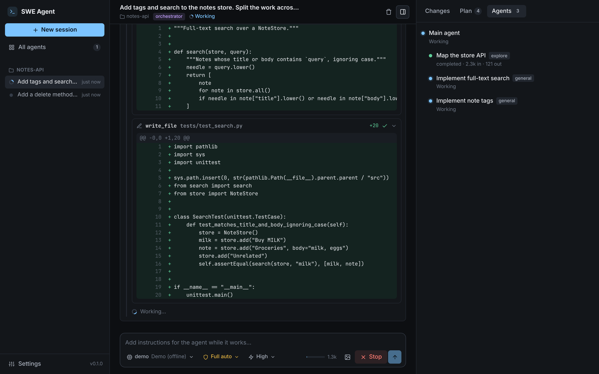

# SWE Agent

An autonomous software engineer for your own machine. It reads the code, plans, edits, runs and verifies, alone or as an
orchestrator leading parallel sub-agents, on whichever model you choose. The agent loop, the tools and the server are written
in Rust; a web UI is embedded in the binary.



A one-minute recording of the UI is in [`site/assets/demo.mp4`](site/assets/demo.mp4), and the project page with the roadmap is
in [`site/`](site/index.html).

> **Status: early (0.1).** The provider adapters have been validated against the live API of every built-in provider with real
> keys, and are tested against local servers that replay each provider's wire format. The agent loop, tools, sessions and UI are
> covered end to end with a scripted demo model. Benchmark results have not been published yet.

## What it does

- **Any model.** Native adapters for the Anthropic Messages API, the OpenAI Responses API and Google Gemini, plus OpenRouter and
  every OpenAI-compatible endpoint (Ollama, LM Studio, vLLM, Groq, DeepSeek, ...). Model lists come live from the provider.
- **A real agent loop.** Streaming, parallel tool calls, retries with backoff, cancellation, messages that steer a running turn,
  and recovery from truncated or malformed tool calls.
- **Tools.** Read, write and edit files, with several edits to one file in a single step; glob and regex search; shell
  commands in the foreground or as background processes; web search and web fetch; a todo list; and any external tool through
  MCP, loaded on demand.
- **Permission modes.** `plan` (read-only), `ask`, `auto-edit` and `full-auto`, with approvals in the UI and "always allow" rules
  per command, path or host.
- **Long runs.** Sessions live in the server, survive a closed browser tab and a restart, and compact their context into a
  hand-over summary when it fills up.
- **Sub-agents and orchestration.** The `task` tool starts `general`, `explore` and `review` sub-agents that run in parallel,
  optionally each in its own git worktree. The `orchestrator` profile plans, delegates, merges and verifies.
- **A UI.** Sessions grouped by workspace, a live timeline with diffs and command output, inline approvals, the plan, the agent
  tree, and a board of every agent across your projects.

## Quick start

You need Rust (1.88 or newer), Node.js 22 or newer, and git.

```sh
git clone https://github.com/Cosmic-Game-studios/SWE_Agent && cd SWE_Agent
npm --prefix ui ci && npm --prefix ui run build   # the UI is embedded into the binary
cargo build --release                             # produces target/release/swe
```

Start the UI from the project you want to work on:

```sh
export ANTHROPIC_API_KEY=...        # or OPENAI_API_KEY, GEMINI_API_KEY, OPENROUTER_API_KEY
cd ~/my-project
swe                                 # serves http://127.0.0.1:4477 and opens the browser
```

Keys can also be entered in the UI under Settings. They are stored in `~/.swe-agent/credentials.json` (mode 0600) and are sent
only to the provider they belong to. A key found in the environment takes precedence and is never written to disk.

Run a single task without the UI:

```sh
swe run --provider anthropic --model claude-opus-5-5 --mode auto-edit "fix the failing tests"
```

No key at hand? `SWE_AGENT_DEMO=1 swe` adds an offline demo model that shows how the loop, tools and approvals work.

## Providers

| Provider id  | API                                  | Key from                         |
| ------------ | ------------------------------------ | -------------------------------- |
| `anthropic`  | Messages API                         | `ANTHROPIC_API_KEY`              |
| `openai`     | Responses API                        | `OPENAI_API_KEY`                 |
| `google`     | Gemini `streamGenerateContent`       | `GEMINI_API_KEY`, `GOOGLE_API_KEY` |
| `openrouter` | Chat Completions                     | `OPENROUTER_API_KEY`             |

Any other OpenAI-compatible endpoint is a few lines in `~/.swe-agent/config.toml`:

```toml
[providers.ollama]
protocol = "openai-chat"
base_url = "http://localhost:11434/v1"
no_key = true

[providers.deepseek]
protocol = "openai-chat"
base_url = "https://api.deepseek.com/v1"
api_key_env = "DEEPSEEK_API_KEY"
```

Supported protocols are `anthropic`, `openai-responses`, `openai-chat` and `gemini`.

### Using a vendor CLI login instead of an API key

A session can run on the `claude` or `codex` command line tool installed on your machine and use whatever login that tool
already has (choose the engine when creating a session, or `swe run --engine claude-cli`). SWE Agent only starts the unmodified
tool and reads its output; it never reads or stores its credentials and has no login flow of its own for these vendors. Whether
a plan covers use through another program is defined by the vendor's terms, so check them. Google's terms exclude this for
consumer plans, which is why Gemini is available with an API key only.

In this mode the vendor tool runs its own loop and tools: approvals during a run, sub-agent orchestration and model switching
are only available with the built-in engine. These engines have been tested against simulated binaries, not the real tools.

## Permission modes

| Mode        | Edits in the workspace | Commands                         | Outside the workspace |
| ----------- | ---------------------- | -------------------------------- | --------------------- |
| `plan`      | blocked                | ask                              | ask                   |
| `ask`       | ask                    | ask                              | ask                   |
| `auto-edit` | allowed                | ask (simple read-only ones run)  | ask                   |
| `full-auto` | allowed                | allowed                          | allowed               |

Fetching from the web asks in every mode except `full-auto`. "Ask" shows the call in the UI with **Allow**,
**Always allow ...** and **Deny** (with optional feedback for the agent). Rules
granted with "always allow" apply to the session and cover a command prefix such as `cargo test`, a directory, a host, or a
tool. Compound shell commands are never covered by a rule.

There is no operating-system sandbox yet. `full-auto` gives the model your user's permissions; use it in a container or on work
you can throw away.

## Sub-agents and the orchestrator

Every agent can delegate with the `task` tool. Calls issued in the same step run in parallel, and each sub-agent starts with a
fresh context and returns a report.

| Type      | Tools                         | Use                                         |
| --------- | ----------------------------- | ------------------------------------------- |
| `general` | everything                    | a self-contained piece of implementation    |
| `explore` | read-only                     | finding and reading code to answer a question |
| `review`  | read-only plus shell          | reviewing a change and running the checks   |

With `isolation: "worktree"` a `general` agent works in its own git worktree on a new branch `swe/<id>`; its work is committed
there and the branch is handed back for merging. Create a session with the **Orchestrator** profile (or
`swe run --agent orchestrator`) for an agent whose job is to plan, split, delegate, integrate and verify.

A cheaper model for sub-agents can be set in Settings or with `subagent_provider` / `subagent_model` in `config.toml`.

## MCP servers

Tools from Model Context Protocol servers (stdio) appear next to the built-in ones as `mcp__<server>__<tool>`:

```toml
[mcp_servers.github]
command = "npx"
args = ["-y", "@modelcontextprotocol/server-github"]
env = { GITHUB_TOKEN = "..." }
```

MCP tools are loaded on demand. Their definitions are not sent to the model until it switches a server on with the `mcp_tools`
tool, and it switches the server off again when it is done, so servers with many tools do not fill the context of every request.
The choice is kept per session. Set `dynamic_mcp_tools = false` in `config.toml` to offer every MCP tool all the time.

## Loop safeguards

- When the agent wants to finish a turn in which it changed files and ran nothing afterwards, it is asked once to verify the
  change (`verify_before_finish = false` turns this off).
- When the context fills up, old and large tool output is dropped first; the conversation is only summarised when that does not
  free enough room.
- A call that fails three times in a row with the same arguments is called out, and an empty response is questioned once.
- After a step that edited files, the project's check runs and its result is attached to the edit: `cargo check` for a Cargo
  project, `tsc --noEmit` where TypeScript is installed locally, `go vet` for a Go module, or the `check_command` from
  `config.toml`. It runs only where the agent may run commands without asking (full-auto, or an "always allow" rule that covers
  it), and switches itself off for the turn when it takes longer than 90 seconds. `auto_check = false` turns it off.

## Rewinding files

Before a file tool changes a file, the agent stores what the file contained. In the UI, every message whose turn changed files
gets a **Rewind** button that puts those files back to their state before that message, undoing that turn and all later ones.
The conversation is kept, and the agent is told what was rewound. Only edits made with the file tools are recorded; what a shell
command changes is not.

## Measuring with `swe eval`

`swe eval <suite>` runs every task of a suite with one model and reports what was solved, with steps, tool calls, failed calls,
time and tokens per task:

```sh
swe eval evals/smoke --provider anthropic --model claude-opus-5-5 --out results.json
```

A task is a directory with a `task.toml` (`prompt`, `check`, optional `timeout_secs`), a `repo/` the agent starts from, and an
optional `hidden/` that is copied in only before the check runs, for tests the agent must not see. Each task runs in a fresh
copy in full-auto mode, so run suites you trust, ideally in a container. `evals/smoke` holds three small Python tasks to try
the harness with; it is not a benchmark.

## Command line

```
swe [serve]        start the server and UI (--port, --host, --token, --no-open)
swe run <prompt>   run one task headless (-C dir, --provider, --model, --mode, --effort, --agent, --engine, --json)
swe eval <suite>   run a suite of tasks and report what was solved (--provider, --model, --task, --out, --keep)
swe providers      list providers and where their keys come from
swe models <id>    list the models of a provider
swe key set|remove store or remove an API key
swe sessions       list sessions
swe engines        show which engines are available
swe home           print the directory with config, credentials and sessions
```

The server listens on loopback only and rejects requests with a foreign `Host` or `Origin`. Listening on another interface
requires `--token`; the UI is then opened with `?token=...`.

## Layout

```
crates/swe-protocol   messages, content blocks and the session event stream
crates/swe-llm        streaming provider adapters and the scripted mock provider
crates/swe-tools      file, search, shell and web tools
crates/swe-core       agent loop, sessions, permissions, compaction, sub-agents, MCP, vendor CLI engines
crates/swe-server     HTTP API, Server-Sent Events, embedded UI
crates/swe-cli        the `swe` binary
ui/                   the web UI (React, TypeScript, Vite)
site/                 the project page
scripts/demo/         records the demo video from the real app
```

## Development

```sh
cargo test --workspace                       # unit, wire-format and end-to-end tests
cargo clippy --workspace --all-targets
cargo fmt --all

# UI with hot reload against a running server
swe serve --no-open --dev-origin http://localhost:5173 &
npm --prefix ui run dev
```

The tests need no network and no API key. Provider adapters are exercised against a local HTTP server that replays each
provider's streaming format; sessions are driven by a scripted provider through the real loop, tools and persistence.

`scripts/demo/record.sh` re-records the demo video and screenshots (needs Playwright and ffmpeg). The model's turns in that
recording come from `scripts/demo/scenarios.txt`; everything else is the real application.

## Roadmap

1. **Trust (0.2):** published benchmark results, an OS-level sandbox, checkpoints and rewind, git actions in the UI, a desktop
   app and prebuilt binaries, cost tracking.
2. **Reach (0.3):** a browser tool, web search, images from tools, project memory, skills and hooks, scheduled jobs.
3. **Team (1.0):** remote runners, issue and pull-request integrations, shared sessions, editor extensions.

The project page in `site/` has the full list.
